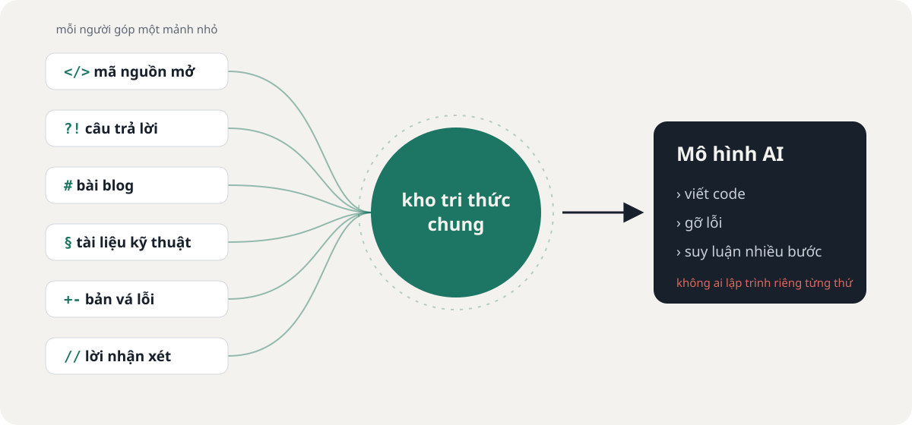
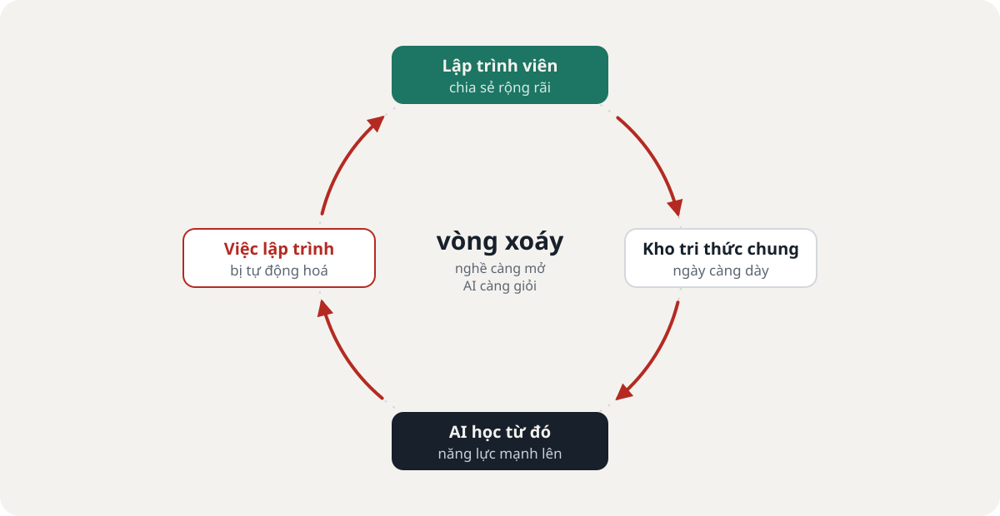
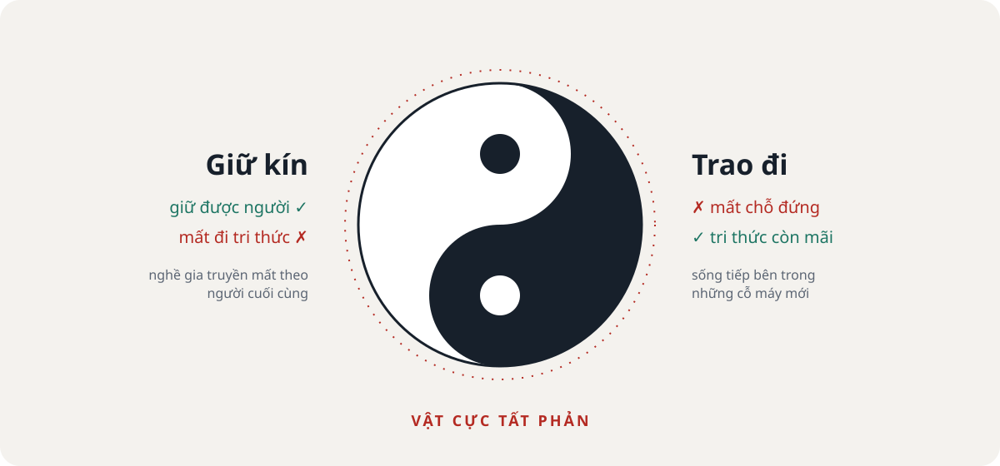
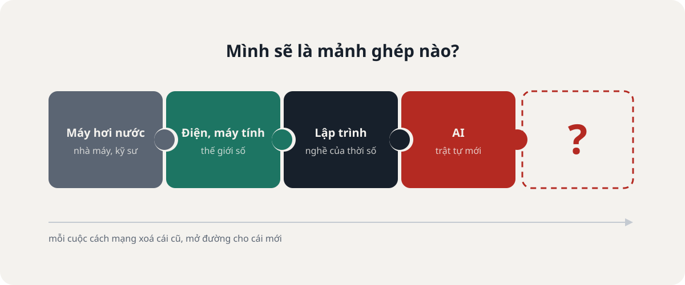

Nếu bạn có một điều rất quý, một kinh nghiệm, một bí quyết, một lời giải, bạn sẽ giữ nó cho riêng mình hay đem chia sẻ cho cả thế giới?

Phần lớn chúng ta được dạy rằng chia sẻ là tốt. Và đúng là như vậy. Nhưng có một nghề đã chia sẻ nhiều đến mức chính sự hào phóng ấy quay ngược lại thành thách thức lớn nhất của họ. Đó là nghề lập trình.

Bài này đi qua một nghịch lý: chia sẻ tri thức đã đưa nghề lập trình lên đỉnh, và cũng chính nó đang đẩy nghề này vào một khúc quanh lớn.

## Một nghề lớn lên nhờ chia sẻ

Tri thức là một thứ tài sản kỳ lạ. Càng trao đi, nó càng sinh sôi. Càng khoá chặt, nó càng cằn cỗi.

Lịch sử lặp đi lặp lại một điều: hễ tri thức bị tư hữu, xã hội lại chững bước. Những bí quyết chỉ truyền trong một dòng họ. Những phát minh bị giam sau bức tường bằng sáng chế. Chúng bảo vệ người nắm giữ, nhưng kìm chân cả cộng đồng.

Nghề lập trình chọn con đường ngược lại.

Đặt cạnh y học hay luật học, những ngành có lịch sử hàng nghìn năm, lập trình là một nghề rất non trẻ. Vậy mà nó lớn nhanh đến chóng mặt. Nếu phải chọn ra một động lực lớn nhất, thì đó là tinh thần chia sẻ.

Lập trình viên viết mã nguồn mở. Họ giải đáp cho nhau trên diễn đàn. Họ viết blog, soạn tài liệu, thậm chí công khai cả những sai lầm của chính mình. Một người đang loay hoay với một lỗi khó ở bên này bán cầu tìm thấy lời giải mà một người hoàn toàn xa lạ ở bên kia để lại từ nhiều năm trước. Chuyện đó, trong nghề lập trình, diễn ra mỗi ngày.

Cứ thế, lập trình viên dần tạo nên một trong những kho tri thức đồ sộ và rộng mở bậc nhất.

*Không ai viết sẵn lời giải cho mọi bài toán. Mỗi người chỉ góp một mảnh nhỏ.*

## AI học từ kho tri thức chung

Nghịch lý bắt đầu từ chính chỗ này.

AI được xây dựng trên kho tri thức khổng lồ mà con người đã tích luỹ, hệ thống hoá và công khai qua nhiều thế hệ: sách vở, giáo trình, công trình học thuật, tài liệu kỹ thuật. Thêm vào đó là dữ liệu được con người tuyển chọn và đánh giá, cùng nhiều vòng huấn luyện bổ sung để rèn khả năng giải quyết vấn đề.

Trong dòng chảy ấy, giới lập trình có một vị trí đặc biệt. Họ liên tục tạo ra và công khai những đóng góp có cấu trúc rõ ràng: mã nguồn, tài liệu kỹ thuật, lời giải cho những vấn đề rất cụ thể. Hiếm ngành nghề nào duy trì được một văn hoá chia sẻ rộng rãi và liên tục như vậy.

Điều thú vị là không ai dạy AI cách thiết kế cả một hệ thống. Cũng không ai viết sẵn lời giải cho mọi bài toán. Mỗi người chỉ góp một mảnh nhỏ: một đoạn code, một câu trả lời, một trang tài liệu, một lời nhận xét.

Vậy những mảnh nhỏ ấy trở thành năng lực bằng cách nào?

Về bản chất, mô hình được huấn luyện để dự đoán phần tiếp theo của một chuỗi văn bản. Nói cách khác, nó học phân phối xác suất ẩn trong dữ liệu. Nghe thì đơn giản. Nhưng để dự đoán tốt trên một khối dữ liệu vừa khổng lồ vừa đa dạng, mô hình buộc phải nắm được những quy luật, cấu trúc và mối liên hệ nằm sâu bên trong nó.

Như thế đã là "hiểu" hay chưa? Câu hỏi đó vẫn còn được tranh luận. Nhưng có một điều rõ ràng: khi dữ liệu, mô hình và tính toán đủ lớn, lại được tinh chỉnh thêm bằng phản hồi của con người, thì những năng lực như viết code, gỡ lỗi hay lập luận qua nhiều bước đã xuất hiện, mà không cần ai lập trình riêng cho từng thứ.

Từ những mục tiêu xác suất tưởng chừng rất đơn giản, năng lực ghép nối và suy luận cứ thế trồi sinh.

## Vòng xoáy và khúc quanh

Đến đây, một vòng xoáy dần khép lại.

*Nghề càng mở, AI càng có điều kiện giỏi lên.*

Nghề càng mở, kho tri thức chung càng dày. Kho tri thức càng phong phú, AI càng có điều kiện phát triển năng lực. Và khi năng lực ấy đủ sức đảm nhận những công việc vốn thuộc về con người, không ít người trong nghề bắt đầu đối mặt với nguy cơ bị thay thế.

Tại sao lại là lập trình viên mà không phải những ngành khác?

Những ngành còn giữ được rào cản về tri thức, về kinh nghiệm thực tiễn, về trách nhiệm hành nghề, cùng những kỹ năng khó mô hình hoá hay tự động hoá, vẫn đang khoác một lớp áo giáp. Lớp áo giáp ấy tạo ra một khoảng đệm.

Còn nhiều công việc lập trình thì đã được số hoá gần như toàn bộ. Đầu vào là văn bản. Đầu ra là văn bản. Kết quả có thể kiểm chứng ngay bằng máy. Chính điều đó khiến chúng trở thành đối tượng rất thuận lợi cho tự động hoá.

Thế là lập trình viên, những người đã hào phóng cho đi, lại nằm trong số những người đầu tiên đứng trước nguy cơ mất chỗ đứng.

Chia sẻ vốn là điều tốt. Không con đường nào đưa xã hội tiến lên nhanh bằng nó. Nhưng khi sự cởi mở diễn ra quá nhanh, chính người trong cuộc cũng không kịp xoay mình khi khúc quanh ập đến.

Lập trình viên vốn quen học một công nghệ mới mỗi năm. Nhưng lần này, cơn sóng không đến từ một ngôn ngữ hay một framework mới. Nó đến từ chính kho tri thức mà họ đã góp phần dựng nên.

## Mặt kia của sự giấu kín

Vậy giấu kín tri thức mới là khôn ngoan?

Chưa chắc. Lớp áo giáp của sự giấu kín cũng có cái giá riêng.

Biết bao nghề thủ công, bao bài thuốc gia truyền, bao bí kíp của các phường hội xưa chỉ được truyền cho một vài người. Rồi khi người cuối cùng nằm xuống, cả một nghề lặng lẽ biến mất theo. Tri thức bị chia cắt và cất giấu thì không bao giờ đủ nhiều để gặp nhau. Và vì không gặp nhau, nó chẳng bao giờ có cơ hội trồi sinh thành điều gì lớn hơn chính nó.

Nghề lập trình thì khác. Tri thức mà lập trình viên chia sẻ đã trở thành phần cốt lõi trong những cỗ máy đang thay thế họ. Nghĩa là mỗi dòng mã, mỗi câu trả lời họ để lại không hề mất đi. Chúng hoà vào một tổng thể mới, sống tiếp và lớn lên bên trong những cỗ máy ấy.

Nghề lập trình có thể không còn được săn đón như trước. Nhưng tri thức mà lập trình viên để lại chắc chắn sẽ được rất nhiều người sử dụng, kể cả những người chưa từng viết một dòng code.

Có điều, câu chuyện này không còn đơn thuần là chuyện công nghệ.

> Tri thức có thể thuộc về toàn nhân loại, nhưng thành quả kinh tế sinh ra từ tri thức ấy chưa chắc được chia cho tất cả những người đã góp phần tạo nên nó.

## Vật cực tất phản

Người xưa có câu mà mình rất thích: "vật cực tất phản". Vạn vật khi đi đến tận cùng, ắt sẽ quay ngược trở lại.

Sự cởi mở của nghề lập trình đã chạm tới cực điểm. Và ngay tại điểm cực ấy, nó quay lại thành mối đe doạ cho chính những người đã tạo ra nó.

Lịch sử cũng xoay vần như thế. Thái bình lâu ngày sinh loạn thế. Loạn thế qua đi, thái bình lại về. Những năm lập trình viên được săn đón là thời thái bình của nghề. Làn sóng AI, cùng những đợt cắt giảm hàng loạt, là loạn thế nối gót theo sau. Nhưng như mọi loạn thế khác, rồi nó sẽ lắng xuống để mở ra một trật tự mới.

Rốt cuộc, tư hữu và chia sẻ giống như âm với dương. Không bên nào đứng mãi ở thế tuyệt đối.

*Tư hữu và chia sẻ, không bên nào đứng mãi ở thế tuyệt đối.*

Giữ kín thì giữ được người, nhưng mất đi tri thức. Trao đi thì mất chỗ đứng, nhưng tri thức còn mãi, thậm chí trồi sinh thành những điều chưa ai từng nghĩ tới.

Trong chia sẻ có mầm đào thải. Và trong đào thải cũng ẩn mầm của một khởi đầu mới.

## Bạn sẽ là mảnh ghép nào?

Nếu bạn đang là lập trình viên, hay đang làm bất kỳ nghề nào đứng trước làn sóng này, mình nghĩ đây không phải lúc để bi quan.

Lịch sử loài người đã đi qua nhiều cuộc cách mạng, và cuộc nào cũng xoá sổ cái cũ để mở đường cho cái mới. Máy hơi nước khiến nhiều nghề thủ công biến mất, nhưng sinh ra nhà máy và người kỹ sư. Điện và máy tính xoá đi rất nhiều công việc lặp lại, nhưng mở ra cả một thế giới số, nơi chính nghề lập trình được sinh ra.

*Mỗi cuộc cách mạng ghép thêm một mảnh. Mảnh tiếp theo còn đang chờ người lấp vào.*

Mỗi lần như thế, người chỉ đứng nhìn cái cũ sụp đổ sẽ bị bỏ lại. Còn người chịu đi tìm xem mình là mảnh ghép nào trong bức tranh mới thì tìm được chỗ đứng của mình.

Âm dương tuần hoàn. Thịnh suy nối tiếp. Đó là nghịch lý mà lập trình viên hôm nay đang phải sống cùng, và cũng là quy luật mà mọi ngành nghề rồi sẽ đi qua.

Vậy nên, khi bức tranh mới đang dần thành hình, câu hỏi đáng đặt ra có lẽ không phải là "mình đã mất gì", mà là: **"mình sẽ là mảnh ghép nào?"**
