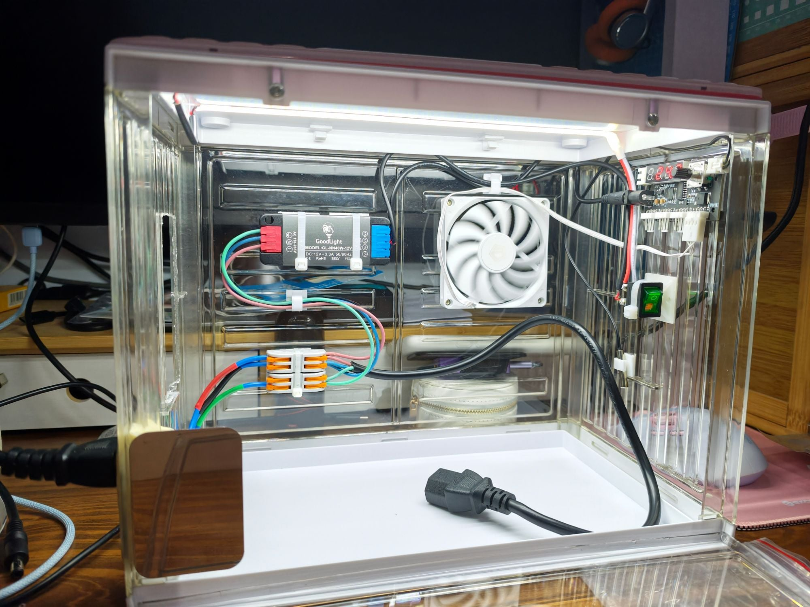
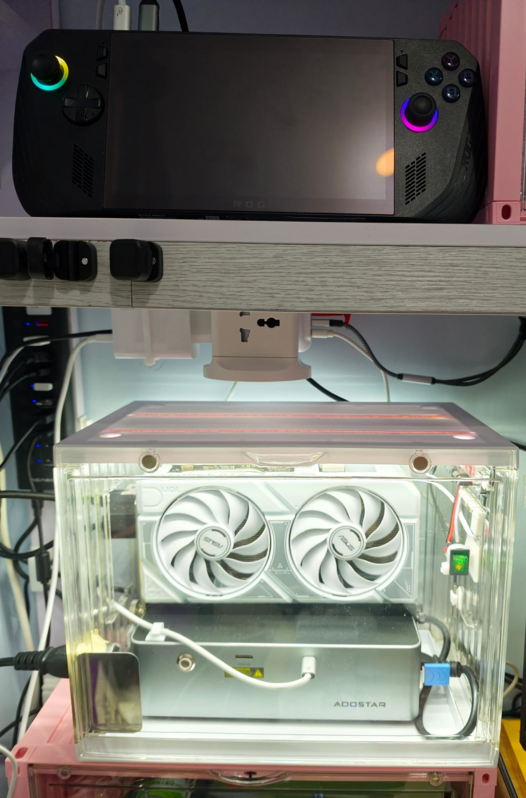

Máy chơi game của mình là một chiếc ROG Ally cắm eGPU. Dock Aoostar nối với máy qua OCuLink hoặc USB4, card ASUS Dual màu trắng gắn ngay trên dock. Bộ này mạnh, nhưng để trần trên kệ thì vài tuần là card bám một lớp bụi.

Bỏ vào hộp kín thì hết bụi nhưng card lại nóng. Nên mình chế một cái hộp vừa kín vừa có gió, và quạt tự chạy nhanh hay chậm theo nhiệt độ bên trong.

## Vỏ hộp

Vỏ là một hộp mica trưng bày, loại hay dùng để đựng mô hình hoặc giày. Mica trong nên vẫn nhìn thấy card. Nắp có sẵn chỗ gắn dải đèn LED, bật lên trông như tủ kính.

Dock nằm dưới đáy hộp, card nằm trên. Mặt trước dock vẫn chừa ra để bấm nút nguồn và cắm dây OCuLink, USB4.

## Bên trong

Toàn bộ mạch gắn ở vách sau, đi dây bằng dây rút cho gọn:

- **Nguồn 12V 3.3A** (GoodLight): lấy điện 220V, đổi ra 12V nuôi quạt, đèn LED và mạch điều khiển.
- **Cút nối Wago**: chia điện 220V từ dây nguồn vào hộp ra hai nhánh, một cho dock, một cho nguồn 12V. Không cần hàn, tháo ra lắp lại dễ.
- **Quạt 12cm** gắn ở vách sau để thay gió trong hộp.
- **Mạch PWM có cảm biến nhiệt**: đọc nhiệt độ trong hộp, hiện lên màn hình LED nhỏ, rồi tự tăng giảm tốc độ quạt. Lúc máy nghỉ thì quạt quay chậm và êm. Lúc chơi game, hộp nóng lên thì quạt quay nhanh hơn.
- **Công tắc tổng** màu xanh: tắt một cái là tắt hết quạt và đèn.

## Đặt lên kệ

Hộp nằm gọn ở tầng dưới kệ, ROG Ally ở tầng trên. Nhìn từ ngoài vào chỉ thấy card trắng và ánh đèn, dây nhợ giấu gần hết phía sau.

Phần mềm để bật tắt eGPU, chọn card cho từng game và xem OSD thì mình tự viết, nằm ở dự án [GPU Toggle Tools](/projects/gpu-toggle-tools/).
