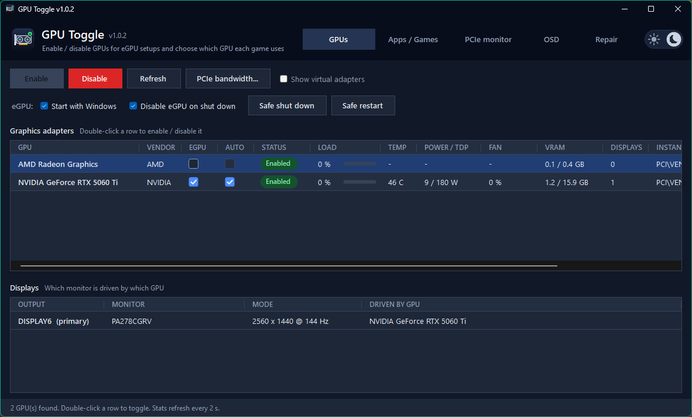
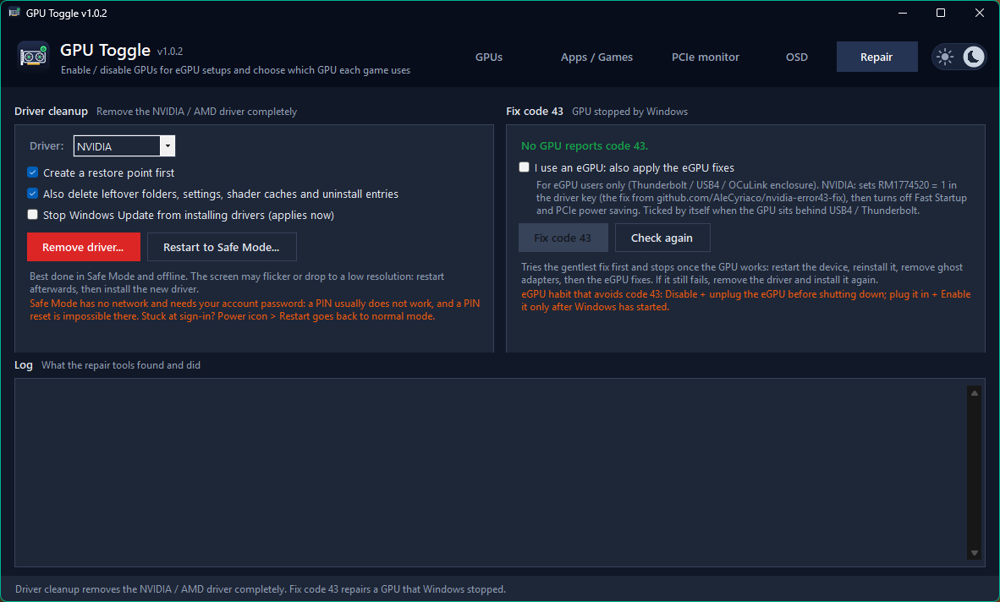

Cắm eGPU qua USB4 hay Thunderbolt giúp laptop mạnh hơn hẳn, nhưng đi kèm nhiều phiền toái nhỏ. Game chạy nhầm sang iGPU. Muốn tắt iGPU thì phải mở Device Manager. Rút dây eGPU lúc card còn chạy thì Windows dễ treo. Và lúc FPS tụt, khó biết lỗi do card, do CPU hay do đường truyền USB4.

GPU Toggle Tools gom hết những việc đó vào một cửa sổ nhỏ. App là một file `.exe` duy nhất, không cần cài đặt, chạy trên Windows 10 (2004 trở lên) và Windows 11.

> Bấm nút **Tải về** ở trên để lấy bản mới nhất, tải xong mở luôn. Những gì thay đổi qua từng bản nằm ở [Nhật ký cập nhật](#nhat-ky-cap-nhat) cuối trang.

## App giúp gì cho người dùng eGPU

| Vấn đề hay gặp | App xử lý thế nào |
|---|---|
| Game chạy trên iGPU thay vì eGPU | Chọn GPU cho từng game, rồi bấm **Launch to test** để xem game thật sự chạy trên card nào |
| Muốn tắt iGPU hoặc eGPU nhanh | Bật/tắt GPU bằng một cú bấm hoặc double-click |
| Tắt nhầm card, màn hình đen | Sau 15 giây không bấm **Keep**, GPU tự bật lại |
| Không biết đường truyền eGPU có bị nghẽn | Đo băng thông PCIe thật và vẽ đồ thị lưu lượng khi chơi game |
| FPS thấp mà không rõ lý do | OSD trong game cho biết FPS đang bị giới hạn bởi GPU, CPU, PCIe hay VRAM |
| Quên Disable eGPU trước khi tắt máy | **Safe shut down** tự Disable eGPU rồi tắt máy, cắm lại thì app tự Enable |
| eGPU báo lỗi Code 43, driver cài hỏng | Trang **Repair** gỡ sạch driver NVIDIA / AMD và thử sửa Code 43 từ nhẹ đến mạnh |

## Bật/tắt GPU

- App tự quét các card đồ họa, hiện hãng, trạng thái và tải của từng card. Danh sách tự làm mới khi bạn cắm hoặc rút eGPU.
- Chọn card rồi bấm **Enable** / **Disable**. App gọi `pnputil` có sẵn của Windows, không cài driver gì thêm.
- Có bảng màn hình: màn hình nào đang được card nào xuất hình, độ phân giải và tần số quét.
- Card NVIDIA hiện thêm nhiệt độ, công suất và tốc độ quạt.

*Trang GPUs: iGPU AMD và eGPU RTX 5060 Ti đều đang bật, RTX 5060 Ti được đánh dấu là eGPU. Màn hình 1440p 144 Hz đang được eGPU xuất hình.*

Hai chốt an toàn giúp bạn không bị kẹt:

1. Tắt GPU cuối cùng còn chạy thì app hỏi lại, nút mặc định là **No**.
2. Sau khi tắt, app đếm ngược 15 giây. Không bấm **Keep** thì card tự bật lại.

## Chọn GPU cho từng game

Trang **Apps / Games** cho biết Windows đang coi card nào là *Power saving* (thường là iGPU) và card nào là *High performance* (thường là eGPU). Thêm game bằng cách chọn file `.exe`, chọn trong danh sách app đang mở, hoặc kéo thả vào cửa sổ.

Cài đặt được ghi vào đúng chỗ của *Settings → System → Display → Graphics*, nên Windows cũng thấy. Cột **Running on** cập nhật mỗi 2 giây, cho biết game đang chạy trên card nào và tải bao nhiêu phần trăm.

*Trang Apps / Games: ELDEN RING được đặt chạy trên eGPU, ứng dụng nhẹ để iGPU lo.*

> Game mở qua Steam hay Epic thì hãy thêm file `.exe` của chính game, không phải của launcher.

## Đo băng thông PCIe

Với eGPU, đường truyền thường là thứ giới hạn đầu tiên. App chép khối dữ liệu 64 MB giữa RAM và VRAM theo cả hai chiều, bấm giờ bằng timestamp của GPU, nên chạy được với card NVIDIA, AMD lẫn Intel.

Kết quả hiện link PCIe đang chạy (ví dụ `Gen4 x4`), băng thông lý thuyết và tốc độ đo thực tế. App tự nhận ra eGPU cắm qua USB4 / Thunderbolt. Trên máy mình, eGPU RTX 5060 Ti chạy link Gen4 x4 đo được khoảng 3,3 GB/s mỗi chiều, chỉ bằng 42 % con số lý thuyết 7,88 GB/s.

Với card NVIDIA, trang **PCIe monitor** ghi lưu lượng 4 lần mỗi giây khi bạn chơi game. Đồ thị tô đỏ những lúc bị nghẽn, kèm nhật ký từng lần nghẽn và nút xuất file CSV.

*PCIe monitor sau 2 phút ghi. Giới hạn đo thực tế là 3,32 GB/s (42 % link), nên app tự đặt ngưỡng nghẽn ở 41 %. Lúc chụp máy chỉ chạy desktop nên lưu lượng còn thấp.*

## OSD trong game

Nhấn **Ctrl+Shift+O** trong game để bật bảng thông số ở góc màn hình: FPS và 1 % low, tải và nhiệt độ GPU, VRAM, CPU, RAM, lưu lượng PCIe. Bảng này click xuyên qua được và không bao giờ cướp focus của game.

Từ bản 1.0.0, mỗi thông số có thể kèm một **đồ thị nhỏ** khoảng 10 giây gần nhất, bật/tắt ở dòng **Graph next to**. Mặc định bật cho FPS và PCIe:

- **FPS**: thang tự co giãn theo FPS cao nhất, nên mỗi lần tụt FPS hay khựng hình hiện thành một cái hố, dễ thấy hơn nhìn con số.
- **CPU**: hai đường, tải tổng và luồng bận nhất. Luồng bận nhất chạm trần trong khi tải tổng thấp là dấu hiệu game bị giới hạn bởi một nhân.
- **PCIe**: hai chiều lên và xuống chung một thang, thấy ngay lúc nào đường truyền eGPU bị dùng hết.

*Trang OSD: chọn thông số nào hiện trên OSD và thông số nào có đồ thị kèm theo. Lúc chụp không có game nào mở nên ô FPS còn trống.*

Dòng **LIM** cho biết thứ đang giới hạn FPS:

| Kết luận | Nghĩa là | Nên làm gì |
|---|---|---|
| GPU-bound | GPU chạy ≥ 95 % | Bình thường. Giảm thiết lập hoặc bật DLSS / FSR nếu muốn thêm FPS |
| CPU-bound | Luồng CPU bận nhất ≥ 90 % | Tăng độ phân giải không mất FPS. Giảm tầm nhìn xa, mật độ NPC |
| PCIe link | Lưu lượng gần chạm giới hạn đo được | Hay gặp với eGPU. Giảm texture, cắm màn hình thẳng vào eGPU |
| VRAM full | VRAM ≥ 95 % | Texture tràn sang RAM rồi đi qua PCIe nên bị giật. Giảm chất lượng texture |

FPS được đọc từ sự kiện mà Windows tự ghi lại (ETW, cùng cách với PresentMon). App **không chèn gì vào game**, nên an toàn với anti-cheat.

> OSD là cửa sổ luôn nằm trên cùng. Game chạy *exclusive fullscreen* có thể che mất nó, khi đó hãy chuyển game sang *borderless*.

## Sửa lỗi driver và Code 43

Bản 1.0.1 thêm trang **Repair**. Các công cụ ở đây can thiệp sâu vào hệ thống nên được tách riêng một trang. Mọi bước đều ghi vào ô **Log** ở cuối trang.

*Trang Repair: gỡ sạch driver bên trái, sửa Code 43 bên phải. Lúc chụp không card nào bị lỗi 43 nên nút Fix code 43 đang mờ.*

### Gỡ sạch driver NVIDIA / AMD

Làm việc giống DDU. Chọn hãng (app tự chọn theo card đang có) rồi bấm **Remove driver...**. App quét trước, ghi ra Log mọi thứ sẽ xoá, hỏi lại rồi mới làm:

1. Tạo restore point.
2. Tắt các chương trình và service của hãng, như NVIDIA App hay AMD External Events.
3. Xoá mọi gói driver của hãng khỏi driver store: driver màn hình, âm thanh HDMI, USB-C...
4. Xoá service, gỡ thiết bị, dọn thư mục còn sót và shader cache.
5. Quét lại phần cứng. Card quay về *Microsoft Basic Display Adapter*, khởi động lại rồi cài driver mới.

Với AMD, app chỉ xoá phần của card Radeon, **không đụng tới driver chipset**. Có thêm ô chặn Windows Update tự cài lại driver cũ ngay sau khi gỡ.

Muốn gỡ sạch nhất thì bấm **Restart to Safe Mode...**. Máy vào Safe Mode đúng **một lần**, lần khởi động sau tự về chế độ thường nên không bị kẹt.

> Safe Mode không có mạng và thường không nhận PIN hay Windows Hello, bạn phải nhập **mật khẩu tài khoản** (với tài khoản Microsoft là mật khẩu Microsoft). Không chắc nhớ mật khẩu thì đừng vào Safe Mode, cứ bấm **Remove driver...** ở chế độ thường, vẫn gỡ được, chỉ kém sạch hơn một chút.

### Fix code 43

Ô trạng thái cho biết card nào đang bị Windows dừng với lỗi **Code 43**. Bấm **Fix code 43**, app thử từ nhẹ đến mạnh và dừng ngay khi card chạy lại:

1. Khởi động lại thiết bị.
2. Gỡ thiết bị rồi quét lại để Windows cài lại từ đầu.
3. Xoá các adapter "ma", tức eGPU từng cắm ở cổng khác, rồi quét lại.
4. Riêng card NVIDIA trong hộp eGPU: ghi giá trị `RM1774520` vào khoá driver của card, cách sửa lỗi 43 quen thuộc trong cộng đồng eGPU. Đồng thời tắt Fast Startup và chế độ tiết kiệm điện của link PCIe.

Bước 4 chỉ chạy khi ô **I use an eGPU** được tick. App tự tick khi card lỗi nằm sau chip USB4 / Thunderbolt. Hộp eGPU cắm qua OCuLink hay M.2 thì bạn tự tick. Card gắn trong máy thì đừng tick. Giá trị này mất khi cập nhật driver, lúc đó bấm **Fix code 43** lại.

## Mẹo khi dùng eGPU

- **Rút eGPU trước khi tắt máy, cắm lại sau khi vào Windows.** Trước khi Shut down hay Restart, **Disable** eGPU trong app rồi rút dây. Mở máy, đăng nhập vào desktop xong mới cắm lại và **Enable**. eGPU có mặt lúc khởi động là nguyên nhân hay gặp của Code 43, màn hình đen và adapter "ma". Windows cũng hay coi đó là phần cứng thay đổi và bắt đặt lại PIN. Từ bản 1.0.2 app làm thay việc này: tick cột **eGPU**, bật **Start with Windows**, rồi mỗi lần tắt máy bấm **Safe shut down**. Cắm eGPU lại thì app tự Enable. Xem [bản 1.0.2](#v1-0-2) để biết chi tiết.

- **Cắm màn hình thẳng vào eGPU.** Nếu màn hình cắm vào laptop, hình phải chạy ngược từ eGPU về qua dây USB4, tốn thêm băng thông vốn đã hẹp.
- **Trước khi tắt iGPU**, bấm `Win + P` và chọn *Second screen only*. Kiểm tra ở *Settings → System → Display → Advanced display* rằng màn hình ngoài đang *Connected to* card eGPU.
- **Màn hình đen?** Thử `Win + Ctrl + Shift + B`, rút ra cắm lại dây màn hình, hoặc chờ 15 giây để app tự bật lại GPU.

## Tải và chạy

1. Tải [GpuToggle.exe bản mới nhất](https://github.com/ncaohoc/GPUToggleTools/releases/latest/download/GpuToggle.exe). Link này luôn trỏ tới bản mới nhất, nên lưu lại để lần sau cập nhật.
2. Mở file vừa tải. App cần quyền Administrator để bật/tắt thiết bị và sẽ tự xin quyền khi mở. Bật **Start with Windows** thì chỉ phải cấp quyền một lần.
3. Số phiên bản hiện ngay trên thanh tiêu đề, cạnh chữ GPU Toggle.

> File exe chưa được ký số, nên lần đầu mở Windows SmartScreen có thể hiện cảnh báo. Bấm **More info → Run anyway** để chạy.

Mỗi bản phát hành trên trang [Releases](https://github.com/ncaohoc/GPUToggleTools/releases) có kèm mã SHA-256 của file exe, dùng để kiểm tra file tải về có đúng không.

App là mã nguồn mở theo giấy phép MIT. Muốn tự build từ mã nguồn thì cũng không cần Visual Studio hay .NET SDK: tải mã nguồn, chạy `build.bat`, script dùng trình biên dịch C# có sẵn trong Windows để tạo ra `GpuToggle.exe`.

Yêu cầu: Windows 10 bản 2004 trở lên hoặc Windows 11, .NET Framework 4.x (có sẵn trong Windows). Các thông số riêng của NVIDIA cần driver NVIDIA.

## Góp ý

App vẫn đang được làm thêm. Nếu bạn dùng eGPU và gặp lỗi, hoặc muốn thêm tính năng, hãy mở [issue trên GitHub](https://github.com/ncaohoc/GPUToggleTools/issues). Kết quả đo từ nhiều loại eGPU khác nhau (Thunderbolt 3, USB4, OCuLink, card AMD) cũng giúp mình rất nhiều.
