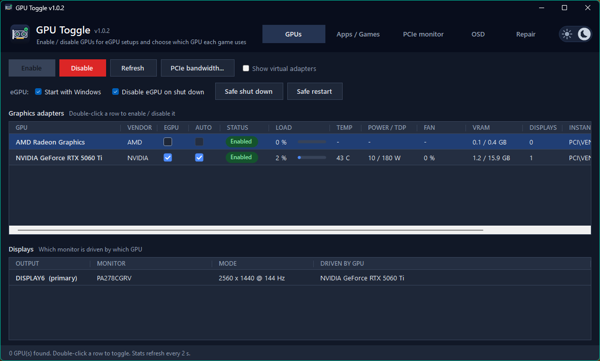

Bản này làm thay bạn thói quen quan trọng nhất của người dùng eGPU: **Disable eGPU trước khi tắt máy, Enable lại sau khi đã vào Windows**. Làm đúng thói quen này thì tránh được lỗi Code 43, màn hình đen và cảnh Windows bắt đặt lại PIN. Trước đây bạn phải tự nhớ và tự bấm. Giờ app lo.

#### Đánh dấu eGPU ngay trên bảng GPU

Bảng card đồ họa ở trang **GPUs** có thêm hai cột tick:

- **eGPU**: đánh dấu card nào là eGPU. Cắm hộp eGPU sang cổng khác thì app vẫn nhận ra đúng card.
- **Auto**: eGPU đang bị Disable thì app tự Enable khi mở app và mỗi lần bạn vừa cắm eGPU vào. Nếu bạn tự tay Disable lúc eGPU vẫn đang cắm, app tôn trọng lựa chọn đó và không bật lại.

*Trang GPUs bản 1.0.2: RTX 5060 Ti được đánh dấu eGPU và bật Auto. Hàng eGPU phía trên gom các tuỳ chọn tự động hoá và hai nút tắt máy an toàn.*

#### Tắt máy an toàn

- Nút **Safe shut down** và **Safe restart**: Disable mọi eGPU đã đánh dấu rồi mới tắt hoặc khởi động lại máy. App tắt máy hẳn, không qua Fast Startup, để lần sau eGPU khởi động sạch. Hai nút này có trên trang GPUs và trong menu chuột phải ở icon khay hệ thống.
- Tuỳ chọn **Disable eGPU on shut down**, mặc định bật: lúc app đang chạy mà bạn tắt máy bằng menu Start như bình thường, app vẫn kịp Disable eGPU trước. Windows chỉ cho app vài giây nên đây là lớp dự phòng, nút **Safe shut down** vẫn chắc hơn.

#### Chạy cùng Windows, hết hỏi UAC

- Bật **Start with Windows** thì app chạy ẩn ở khay hệ thống ngay sau khi bạn đăng nhập, tức là sau bước nhập PIN. Nhờ vậy việc Enable eGPU xảy ra sau khi Windows đã khởi động xong, không làm Windows tưởng phần cứng bị đổi.
- App dùng một task trong Task Scheduler nên **chỉ hỏi quyền Admin một lần** lúc bật tuỳ chọn. Từ đó mở app bằng file exe cũng không còn hiện UAC.
- App chỉ chạy một bản. Mở thêm lần nữa thì cửa sổ đang chạy hiện lên. Khi bật Start with Windows, nút X chỉ ẩn cửa sổ xuống khay, muốn thoát hẳn thì chuột phải icon ở khay → **Exit**.

#### Cách dùng gợi ý

Làm một lần: tick **eGPU** cho card eGPU và bật **Start with Windows**. Từ đó mỗi ngày chỉ còn:

1. Bấm **Safe shut down**, đợi máy tắt rồi rút dây eGPU.
2. Mở máy, đăng nhập vào desktop.
3. Cắm eGPU. App tự Enable, không cần mở Device Manager hay bấm gì thêm.
